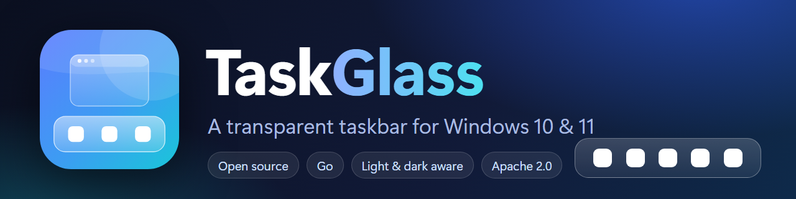

<p align="center">
  
</p>

<p align="center">
  <a href="https://github.com/AnderCMD/TaskGlass/actions/workflows/ci.yml"></a>
  <a href="https://github.com/AnderCMD/TaskGlass/releases/latest"></a>
  <a href="LICENSE"></a>
</p>

TaskGlass vuelve la barra de tareas de Windows **totalmente transparente, con desenfoque o acrílica**, de modo que solo se vean los iconos, y hace translúcido también el desplegable con los iconos ocultos de la bandeja. Solo hace eso. Es una app de bandeja pequeña escrita en Go (sin cgo) más una DLL nativa auxiliar, sin runtime que instalar. Sigue el modo claro y oscuro de Windows.

**Sitio web con descargas y guía paso a paso: [andercmd.github.io/TaskGlass](https://andercmd.github.io/TaskGlass/)** · [Read in English](README.md)

## Características

- Estilos **Clear / Blur / Acrylic / Opaque / Normal**, incluida la transparencia total en la barra XAML de Windows 11 (sin relleno gris ni línea de borde)
- **Modo claro y oscuro**: los colores `auto`, el icono y el menú de la bandeja siguen a Windows en vivo
- **Desplegable de la bandeja translúcido**: el desplegable con los iconos ocultos (el botón `^`) tiene su propia opacidad
- **Reglas inteligentes**: un aspecto opcional con una ventana maximizada, o por aplicación (`code.exe`, `chrome.exe`, ...)
- **Atajo global** para activar o desactivar el efecto (desactivado por defecto, se activa con un interruptor), e interruptor general
- **Multimonitor**: cada barra por separado, o solo la principal
- **Por eventos**: reacciona a eventos de ventana en lugar de sondear, cerca de 0 % de CPU en reposo
- **Robusto**: resiste reinicios de Explorer, restaura la barra al salir e incluso tras un cierre inesperado, conserva la configuración anterior si rompes el archivo, se recupera de errores internos
- Configuración JSON con recarga en caliente y esquema para autocompletado, menú de bandeja, inicio con Windows, instancia única

## Instalación

**Instalador (recomendado):** descarga `TaskGlass-<versión>-Setup.exe` desde [Releases](https://github.com/AnderCMD/TaskGlass/releases) y ejecútalo. Se instala por usuario (sin permisos de administrador), añade una entrada al menú Inicio, puede iniciar TaskGlass con Windows y su desinstalador restaura la barra. Inglés y español.

**Portable:** descarga el zip, extráelo en una carpeta permanente (por ejemplo `%LOCALAPPDATA%\Programs\TaskGlass`) y ejecuta `taskglass.exe`. Deja `taskglass_tap.dll` en la misma carpeta: es lo que hace totalmente transparente a Windows 11 (ver [Cómo funciona](#cómo-funciona)). TaskGlass vive en el área de notificaciones; haz clic derecho en su icono.

Compilar desde el código (Windows, Go 1.26+ y un compilador MinGW-w64 para la DLL, p. ej. `winget install MartinStorsjo.LLVM-MinGW.UCRT`):

```bash
go build -ldflags "-H=windowsgui -s -w" -o dist/taskglass.exe ./cmd/taskglass
powershell -File scripts/build-tap.ps1   # genera dist/taskglass_tap.dll
```

## Uso

Clic derecho en el icono de bandeja para activar o desactivar TaskGlass, elegir estilo o tema, alternar las reglas, iniciar con Windows, o abrir la configuración y el log.

Una configuración mínima: barra transparente, opaca si algo está maximizado, y desenfoque teñido en tu editor:

```json
{
  "version": 1,
  "default":   { "accent": "clear" },
  "maximized": { "enabled": true, "accent": "opaque" },
  "apps": [ { "exe": "code.exe", "accent": "blur", "color": "#101828", "opacity": 55 } ],
  "hotkey_enabled": true,
  "hotkey": "Ctrl+Alt+G"
}
```

Todas las opciones, la prioridad de reglas y los flags de línea de comandos están en [docs/configuration.md](docs/configuration.md).

Archivos: config `%APPDATA%\TaskGlass\config.json`, log `%LOCALAPPDATA%\TaskGlass\taskglass.log`.

## Cómo funciona

Windows tiene una API de acento no documentada, `SetWindowCompositionAttribute`, con la que TaskGlass difumina o tiñe la barra. En Windows 11 la barra pinta además su propio relleno XAML gris semitransparente y un borde encima, así que el acento por sí solo nunca llega a ser totalmente transparente.

Para quitar ese relleno, `taskglass_tap.dll` se carga dentro de `explorer.exe` mediante la API XAML Diagnostics, localiza los rectángulos `BackgroundFill` y `BackgroundStroke` de la barra y pone su opacidad a 0 mientras TaskGlass está en marcha. Si TaskGlass se cierra o falla, la DLL lo detecta y restaura el aspecto original por sí sola. Detalles en [docs/architecture.md](docs/architecture.md).

## Antes de empezar

**Desactiva** *Mostrar el color de énfasis en Inicio y en la barra de tareas* en Windows (Configuración > Personalización > Colores). Mientras esté activo, Windows pinta la barra con tu color de énfasis y anula el efecto que aplica TaskGlass, así que la barra no se verá transparente.

## Limitaciones y seguridad

- Depende de funciones internas no documentadas de Windows. Una actualización puede romperlo; en ese caso la app sigue con efectos de acento (tintes y desenfoque) y registra el motivo.
- Cargar código en Explorer es lo que las herramientas de seguridad llaman "inyección", y algunos antivirus pueden avisar. La DLL es pequeña y su código está en [native/tap](native/tap); puedes compilarla tú. Con `"xaml_fix": false` nunca se toca Explorer.
- Verificado en Windows 11 compilación 26300 con un monitor y ocultado automático. Windows 10 (sin barra XAML) solo necesita la API de acento y no está probado; multimonitor tampoco. [Abre un issue](https://github.com/AnderCMD/TaskGlass/issues) indicando tu versión de Windows si algo se ve mal.
- Si la barra se ve mal: `taskglass.exe --restore`, o reinicia Explorer.

## Sitio web

La carpeta `site/` es una página estática bilingüe (español/inglés) para quien no conoce GitHub: descargas del instalador y de la versión portable (se leen del último release), pasos de instalación y preguntas frecuentes. `.github/workflows/pages.yml` la publica en GitHub Pages cada vez que `main` la cambia.

## Hoja de ruta

- Verificación en Windows 10 y multimonitor
- Paquete winget

## Contribuir

Ver [CONTRIBUTING.md](CONTRIBUTING.md). Seguridad: [SECURITY.md](SECURITY.md).

## Licencia

[Apache License 2.0](LICENSE). Ver también [NOTICE](NOTICE).
