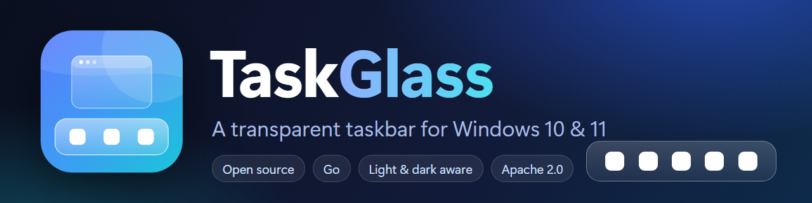

<p align="center">
  
</p>

<p align="center">
  <a href="https://github.com/AnderCMD/TaskGlass/actions/workflows/ci.yml"></a>
  <a href="https://github.com/AnderCMD/TaskGlass/releases/latest"></a>
  <a href="LICENSE"></a>
</p>

TaskGlass makes the Windows taskbar **fully transparent, blurred or acrylic**, so only the icons remain, and makes the flyout with the hidden tray icons translucent too. That is all it does. It is a small tray app written in Go (no cgo) plus a native helper DLL, with no runtime to install. It follows Windows' light and dark mode.

**Website with downloads and a step-by-step guide: [andercmd.github.io/TaskGlass](https://andercmd.github.io/TaskGlass/)** · [Leer en español](README.es.md)

## Features

- **Clear / Blur / Acrylic / Opaque / Normal** styles, including truly transparent on the Windows 11 XAML taskbar (no grey fill, no border line)
- **Light and dark aware**: `auto` colours, the tray icon and its right-click menu follow Windows, live
- **Translucent tray flyout**: the flyout with the hidden icons (the `^` button) gets its own opacity
- **Transparent by default, everywhere**: also with a maximized window; an optional look when one is maximized, or per application (`code.exe`, `chrome.exe`, ...)
- **Global hotkey** to toggle the effect (off by default, one switch to enable), and a master on/off switch
- **Multi-monitor**: every taskbar handled independently, or only the primary one
- **Event driven**: reacts to window events instead of polling, about 0 % CPU when idle
- **Robust**: survives Explorer restarts, restores the taskbar on exit and even after a crash, keeps the previous settings when you break the config file, recovers from internal errors
- Hot-reloaded JSON config with a schema for editor completion, tray menu, start with Windows, single instance

## Install

**Installer (recommended):** download `TaskGlass-<version>-Setup.exe` from the [Releases](https://github.com/AnderCMD/TaskGlass/releases) page and run it. It installs per user (no administrator rights), adds a Start menu entry, can start TaskGlass with Windows, and its uninstaller restores your taskbar. English and Spanish.

**Portable:** download the zip, extract it somewhere permanent (for example `%LOCALAPPDATA%\Programs\TaskGlass`) and run `taskglass.exe`. Keep `taskglass_tap.dll` in the same folder: it is what makes Windows 11 fully transparent (see [How it works](#how-it-works)). TaskGlass lives in the notification area; right-click its icon.

Build from source (Windows, Go 1.26+, and a MinGW-w64 compiler for the helper DLL, e.g. `winget install MartinStorsjo.LLVM-MinGW.UCRT`):

```bash
go build -ldflags "-H=windowsgui -s -w" -o dist/taskglass.exe ./cmd/taskglass
powershell -File scripts/build-tap.ps1   # builds dist/taskglass_tap.dll
```

## Usage

Right-click the tray icon to enable or disable TaskGlass, pick a style or a theme, toggle the rules and the tray flyout, start with Windows, or open the config and the log.

A minimal config that makes the bar clear, opaque when something is maximized, and a tinted blur in your editor:

```json
{
  "version": 1,
  "default":   { "accent": "clear" },
  "maximized": { "enabled": true, "accent": "opaque" },
  "apps": [ { "exe": "code.exe", "accent": "blur", "color": "#101828", "opacity": 55 } ],
  "hotkey_enabled": true,
  "hotkey": "Ctrl+Alt+G"
}
```

Every option, the rule priority and the command-line flags are in [docs/configuration.md](docs/configuration.md).

Files: config `%APPDATA%\TaskGlass\config.json`, log `%LOCALAPPDATA%\TaskGlass\taskglass.log`.

## How it works

Windows exposes an undocumented accent API, `SetWindowCompositionAttribute`, that TaskGlass uses to blur or tint the taskbar. On Windows 11 the taskbar additionally paints its own semi-transparent grey XAML fill and border on top, so the accent alone can never be fully clear.

To remove that fill, `taskglass_tap.dll` is loaded into `explorer.exe` through the XAML Diagnostics API, finds the taskbar's `BackgroundFill` and `BackgroundStroke` rectangles and sets their opacity to 0 while TaskGlass runs. If TaskGlass exits or crashes, the DLL notices and restores the stock look by itself. Details in [docs/architecture.md](docs/architecture.md).

## Before you start

Turn **off** *Show accent color on Start and taskbar* in Windows (Settings > Personalization > Colors). While it is on, Windows paints the taskbar with your accent color and overrides the effect TaskGlass applies, so the bar will not look transparent.

## Limitations and safety

- This relies on undocumented Windows internals. A Windows update can break it; the app then falls back to accent-only effects (tints and blur still work) and logs why.
- Loading code into Explorer is what security tools call "injection" and some antivirus products may flag it. The DLL is small and its source is in [native/tap](native/tap); you can build it yourself. Set `"xaml_fix": false` to never touch Explorer.
- Verified on Windows 11 build 26300 with a single monitor and auto-hide enabled. Windows 10 (no XAML taskbar) only needs the accent API and is untested; so are multi-monitor setups. Please [open an issue](https://github.com/AnderCMD/TaskGlass/issues) with your Windows build if something looks off.
- If the taskbar ever looks wrong: `taskglass.exe --restore`, or restart Explorer.

## Website

The `site/` folder is a static bilingual page (Spanish/English) for people who are not familiar with GitHub: installer and portable downloads (resolved from the latest release), install steps and an FAQ. It is published to GitHub Pages by `.github/workflows/pages.yml` whenever `main` changes it.

## Roadmap

- Windows 10 and multi-monitor verification
- winget package

## Contributing

See [CONTRIBUTING.md](CONTRIBUTING.md). Security issues: [SECURITY.md](SECURITY.md).

## License

[Apache 2.0](LICENSE)
